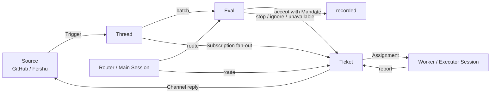
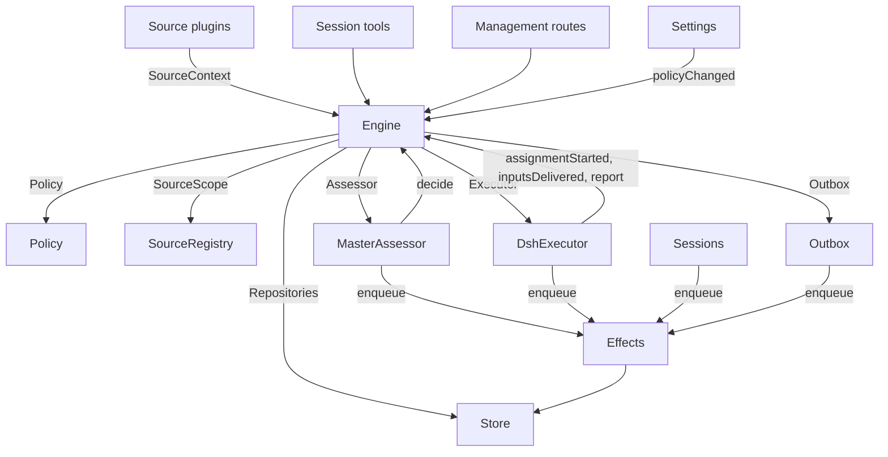

# dsh-superagent 的 Router–Worker 架构分析

> 本文分析 dsh-superagent 的核心运行模型：一个「路由器（Router / 编排者）」负责评估与派单，多个「工人（Worker / 执行器）」各自负责一张工单的实现。文中概念与代码对应关系取自仓库 `src/`，实现边界参考 `docs/007-architecture.md`。
>
> 说明：dsh-superagent 是一个「面向单个 GitHub 仓库」的主动式编码智能体，打包为 DeepSeek Harness 的一个 bundle。它倾听 GitHub（可选 Feishu），在有人被允许向它请求工作时，打开一张工单，在自己的智能体会话与目录里完成，然后在原始对话中答复，例如以一个 Pull Request 交付。

---

## 1. 一句话概括

dsh-superagent 把「**接收与决策**」和「**执行与实现**」分成两个角色：

- **Router（`orchestrator`，主会话 / Main Session）**：负责把外部事件收进来、做授权与准入判断、决定是否以及如何开一张工单，然后把工单**派**给一个执行器，并在需要时把答复发回原渠道。
- **Worker（`worker`，执行器会话 / Executor Session）**：每张工单一个专属会话与工作目录，**负责技术实现**：读上下文、评估范围、选择方案、验证结果、提交 PR，并在结束时向 Router 汇报。

Router 强调「少打扰、少看代码、不替工人做技术决定」；Worker 强调「自己拿下技术工作、只把真正需要人的结果或阻塞报上来」。二者的边界由 `Engine`（领域引擎）与一套严格的最小工具集、订阅与汇报协议来保证。

---

## 2. 核心设计原则

来自 `docs/000-philosophy.md` 的「**尽可能少占用人的注意力，尽可能多地创造价值**」直接决定了 Router–Worker 分工：

| 原则 | 对 Router 的要求 | 对 Worker 的要求 |
| --- | --- | --- |
| 只在该动手时动手 | 只有被允许的人直接请求，或团队写好的规则允许时，才会开工 | 在授权范围内自主推进，不因「未获确认」就停下问人 |
| 只在必须时开口 | 确认请求一次，然后闭嘴；结果就绪、需要决策、或无法完成时才再说话 | 把「就绪 / 阻塞 / 失败」等状态结构化上报，不把内部过程当消息 |
| 按影响而非工作量停止 | 局部改动做到「可评审」为止 | 需要设计决策时停下，给出明确问题 |
| 诚实汇报 | 草稿标为未完成、失败标为失败 | 受限不绕过、不为了避开询问而隐瞒 |

由此引申出的架构要点：

1. **Few concepts（少概念）**：领域只有 Source、Trigger、Thread、Ticket、Mandate、Assignment、Subscription 等少数概念；业务需要尽量变成「某个概念的属性」或「一段提示词」，而不是新概念。
2. **One writer per state（单写者）**：每种状态只有一个写入者，其他人只读或向它请求；这是 Router 与 Worker 不打架的根基。
3. **窄依赖与最小工具集**：Router 与 Worker 各自只拿到「自己角色该有的 `Pick` 接口」和「自己角色该有的工具」，从机制上防止越权。

---

## 3. 领域模型与一次完整的工作流

### 3.1 概念速览

| 概念 | 中文 | 一句话 |
| --- | --- | --- |
| Source | 来源 | 一种事件流，如 GitHub / Feishu；一个种类 = 一个可复用实现，一个实例 = 一份配置（开着与否、听什么） |
| Trigger | 触发 | 一条带 Source 元数据（比如发送者）的**不可变**事件；是审计与幂等的最小单位 |
| Thread | 线程 | 按时间排序的一组 Trigger；同一条 Trigger 可能属于多个 Thread；一个 Thread 同一时刻至多跑一个 Eval |
| Channel | 渠道 | Thread 的「写入侧」；确认、答复、PR、评审答复都是写入 |
| Policy | 策略 | 版本化的评估规则，以及每个 Source 自己的准入名单、同步方式、机器人名单 |
| Eval | 评估 | 对一批 Trigger 的判断，分「准入门（gate）」与「研判（assessment）」两层，输出一个 Decision |
| Ticket | 工单 | 一个被授权的「工作单元」，由 Eval 创建；持有自己的 Channel、Inputs、状态 |
| Mandate | 授权 | 一次「接受」给到的权限：策略版本、范围、强度、匹配的规则、发送者身份 |
| Assignment | 派工 | 把一张工单与某一个执行器实例绑定；有 pending → running → ended 生命周期 |
| Subscription | 订阅 | 工单与 Thread 之间的多对多关系；命中订阅的 Trigger 会「扇出」给订阅的工单作上下文 |

### 3.2 数据流总览

用文字描述一次完整流程（以用户在一个 GitHub issue 或 Feishu 群里 @ 机器人为例）：

1. **Source 采集**：GitHub / Feishu 的轮询或事件消费把外部事件变成 `Trigger`，调用 `Engine.receive(trigger)`。
2. **Intake（摄入）**：去重（重复返回 `duplicate`）、按 `SourceScope` 过滤（不在监听范围内返回 `filtered`）；否则存下 Trigger，更新它所属的 Thread 及其关联关系，并向订阅这些 Thread 的工单**扇出**（作为 `Input` 上下文）。
3. **Eval（评估）**：若没有工单的 worker 决定这条 Trigger，它进入其主 Thread 的 Eval 队列。`evaluateDue` 会启动一个 Eval：先过 **gate**（谁可以开工、什么强度），再交给 **MasterAssessor**（模型研判）生成候选卡片。
4. **Router 决策**：候选卡片被送到主会话（`orchestrator`）。Router 用 `orchestrator_route` 决定 `accept` / `attach` / `stop` / `ignore`。`accept` 会原子地创建 Ticket、Mandate、Assignment、Subscriptions 并在原渠道**确认**一次。
5. **派工与执行**：`DshExecutor` 为工单准备目录（可选 `prepare` 命令，典型是 `git worktree`），创建 `worker-<ticket id>` 会话，用 `launch` 效果启动。
6. **Worker 实现**：worker 在其专属目录里读上下文、写代码、跑检查、提交 PR；用 `orchestrator_report` 上报 `progress / ready / blocked / failed / dropped`。
7. **汇报与答复**：`report` 记入工单的 Assignment；`ready` 结束工单；`result` / `attention` 等渠道写入经 `Outbox` 发回原对话。

---

## 4. Router（编排者 / 主会话）

在代码里，主会话的角色是 `orchestrator`，使用 `dsh-superagent-router` 预设（`ROUTER_PRESET`）。它的系统提示词就是 `prompts/orchestrator.md` + `prompts/dispatch.md` + `prompts/admission.md`。

### 4.1 Router 做什么

- **接收并路由候选**：新候选、`worker_report`、`follow_up` 通知、后台任务结束等都会作为消息自动进入其回合。
- **评估主动候选**：对「规则允许的主动观察」，用 `orchestrator_eval` / `orchestrator_eval_read` / `orchestrator_eval_decide` 在会话内做只读研判。
- **派单 / 挂接 / 停止 / 忽略**：`orchestrator_route` 一次接受 1–20 个决策（每个以一个 `trigger_id` 为准，决定其批次）。
- **管理与学习**：`orchestrator_read` 读上下文；`orchestrator_reply` 发送答复；`orchestrator_ticket_*` 管理工单；`orchestrator_settings_save` / `policy_sync` / `prompts_save` 配置。

### 4.2 Router 的工具（主会话 14 个应用工具）

| 用途 | 工具 |
| --- | --- |
| 读与路由 | `orchestrator_read`、`orchestrator_route` |
| 工单管理 | `orchestrator_ticket_retry`、`orchestrator_ticket_request_status`、`orchestrator_ticket_note` |
| 重新评估 | `orchestrator_trigger_requeue` |
| 主动评估 | `orchestrator_eval`、`orchestrator_eval_read`、`orchestrator_eval_decide` |
| 通讯与退订 | `orchestrator_reply`、`orchestrator_thread_unsubscribe` |
| 配置 | `orchestrator_settings_save`、`orchestrator_policy_sync`、`orchestrator_prompts_save` |

主会话还保留 DSH 的 `skill`、`bash`、`read`、`read_image`、`job_output`、`job_list`、`job_kill`。**「不看代码」是提示词规则，不是工具限制**——它被明确要求不要把 Router 变成第二个 Worker。

### 4.3 Router 被刻意约束的部分

- 只以部署方的 GitHub 账号行事；不合并、不自行开自动合并、不关 issue、不把私密 Feishu 内容暴露到 GitHub。
- **不替代 Worker 做技术实现**：不读代码、不设计技术方案、不翻译 Worker 的问题成自己的技术决定、不添加验收标准或实现计划。
- **不主动等**：报告、follow_up、新候选和后台任务结束都会自己作为消息到达，提示词明确要求「不要 sleep / 轮询 / 等待，没别的事就结束回合」；代码里还有一个 `noWait` 守卫拒绝主会话里 `sleep`、超 30 秒的 shell 命令、以及超 5 秒的 `job_output` 等待。
- **不重复交付**：同一个里程碑不会因为又来了一个 report 或 CI 通知就再发一次。

### 4.4 候选卡与评估上下文

`orchestrator_eval` 返回的是**上下文而非指令**；真正的评估指令在 `prompts/admission.md`，规则在 `runtime/policy`。其上下文包括：

- Trigger 文本（最多 4000 字符，含 image id 与同批其他 Trigger）。
- 最多 8 个 `related_tickets`（open 优先），以及 `tickets_total`。
- 该 Eval 的 `policy_version`。
- Thread 窗口：前 5 条 + 触发点前后各 5 条；长消息会截断并给出 `chars`。
- 其余消息作为 50 字符的 stub，可用 `orchestrator_eval_read` 按 id 展开。

评估必须「面向具体变更意图」，并建立三个独立事实：讨论针对本项目、参与者表达了实现特定变更的意图、方向已足够确定适合做小的局部改动。**方向未定的视觉 / 风格偏好不被当作实现请求**；若仍不确定，就安静忽略，让后续消息确立。

---

## 5. Worker（执行器会话）

每张工单会有且只有一个**常驻**的执行器会话 `worker-<ticket id>`，以及一个以其短名命名的专属工作目录。预设为 `dsh-superagent-worker`（`WORKER_PRESET`）。

### 5.1 Worker 的工具（6 个应用工具）

| 工具 | 用途 |
| --- | --- |
| `orchestrator_read` | 只读本工单可读的资源 |
| `orchestrator_ack` | 对一个原始请求先做一次简短确认 |
| `orchestrator_report` | 上报进展/结果，按 PR 规则绑定 PR |
| `orchestrator_thread_unrelated` | 把一个被挂接的相关 Thread 标记为无关并说明原因 |
| `orchestrator_thread_follow` | 订阅一个相关 Thread 仅供上下文 |
| `orchestrator_trigger_handback` | 把「超出本工单 / 属于其他工单」的消息一次性地交还 |

Worker 还**保留** DSH 的「干活」工具：`read`、`write`、`edit`、`read_image`、`glob`、`grep`、`bash`、`pwsh`、`job_output`、`job_list`、`job_kill`、`web_search`、`web_fetch`、`skill`、`todo_write`、`subagent`、`send_message`、`list_agents`、`interrupt_agent`（`WORK_TOOLS`）。

**刻意不给 Worker 的工具**：不给人提问或展示、不改造 profile、不在 worker 槽位之外调度工作、不启动或给其他会话发消息、不编辑外部文档。工单结束后，工具调用会被拒绝。

### 5.2 Worker 的授权边界

- Worker 的系统提示词来自 `prompts/worker.md`（含 `scope`、`communication`、`delivery` 等块）。
- 对**主动（inferred）**授权，系统提示词里会额外插入一段：*「本工单授权范围有限，请独立验证它确实是规则范围内某个模块内部的小改动；若涉及公共接口/行为变更、新交互、产品决策或需要澄清，就停下并 report dropped，不要扩大范围。」* 这段来自 `mandateInstructions`。
- 对**显式（explicit）**请求（有人直接 @ 机器人的授权请求），则直接派单，不做这种范围收缩。

### 5.3 Worker 与后台工作 / 并发槽位

- **Worker slot**：从 launch（含 prepare）开始，或从「唤醒空闲执行器的交付」开始，直到一轮 turn 结束；只要后台还有 shell job 或 subagent 在跑，就继续持有槽位。
- **后台限制**：一轮结束后，后台工作最多 30 分钟；到限则杀掉 shell job，并上报 `waiting`（会说明杀掉了哪些 job / 还有哪些 subagent 在跑）。subagent 允许继续。
- **交还给人（handoff）**：`ready` 报告之后、或提出一个需要人回答的问题之后（除非又有新 Input 到达）、或任何 `blocked` / `failed` 报告之后，执行器会立刻**释放槽位**，把结果留给人的下一步动作。交给人的 shell job（比如一个可用来评审的服务器）可以继续到 Assignment 结束，且不占槽位。
- **并发上限**：配置的 `executor.maxWorkers` 决定同时运行的槽位数；**另有一个额外槽位专门留给人的消息 / 状态请求**，保证新工作不会阻止人继续处理已有工单。
- **现场恢复**：插件停止/重启时，正在 `running` 的 Assignment 会在重启后以一条 `recovery note` 继续（除非它已 `waiting/ready/blocked/failed` 且其后没有新 Input）。

---

## 6. Router–Worker 之间的「通讯协议」

两者不直接互相调用，而是通过 **`Engine`** 串联，再借助一套**消息/汇报**协议、**订阅**与**Outbox** 在「不同进程/会话」间通信。

### 6.1 经 Engine 的角色接口

`Engine` 返回给每个调用者一个**只含其角色所需方法**的 `Pick` 接口：

| 角色 | 接口 | 拿到的能力 |
| --- | --- | --- |
| Sources | `EngineForSources` | `receive`、`bindThread`、`threadClosed` |
| 主会话 | `EngineForMainSession` | `candidate`、`candidateDelivered`、`decide`、`attach`、`reply`、`requestStatus`、`note` |
| 人（面板/主会话） | `EngineForPeople` | `stopTicket`、`retryTicket`、`reevaluate`、`unsubscribe`、`dismiss` |
| Settings | `EngineForSettings` | `policyChanged` |
| Executor | `EngineForExecutor` | `assignmentStarted`、`inputsDelivered`、`inputsRead`、`turnEnded`、`deliveryFailed`、`assignmentInterrupted`、`report`、`markUnrelated`、`handback`、`followForContext`、`reply` |

参与方只能拿到自己角色的那面，这就是「权力最小化」。

### 6.2 消息送达与通知

- **进入主会话回合的消息**：`Candidate`（候选卡）、`follow_up`（人的消息，指明接收工单）、`worker_report`（工单卡 + 状态 + ≤600 字符摘要）、`worker_attention`（带问题）。
- **注入但不唤醒主会话的通知**：`ticket_ended`、`settings_saved`、prompt 保存、Trigger 重排队、退订、上下文关注等。
- **给 Worker 的消息**：Assignment 与 Inputs **内联**送达。首条消息含标题、≤1500 字符的派工文本、以及 source Trigger 卡；Input 带 Trigger 卡（≤600 字符）或纯文本。
- **到达即处理的去重**：`AgentDelivery` 保证同一 `requestId` 至多送达一次，跨会话恢复也如此。

### 6.3 汇报（Report）协议

Worker 通过 `orchestrator_report` 上报，状态机为：

| 状态 | 含义 |
| --- | --- |
| `progress` | 内部进展，不唤醒主会话、不触发 IM |
| `ready` | 已自审、已验证、可供人审阅的结果；会结束工单（若没有需要继续关注的 Thread） |
| `blocked` | 确实没法推进，且需要人行动 |
| `failed` | 执行失败 |
| `dropped` | 没有需要人做的事（未复现 / 非缺陷 / 已记录），关闭工单且不打扰 |

`ready` 报告是「可交付」的分界线；**创建 PR 不等于 ready**。报告里的 `human_action` 是「一个具体的、要人回答的问题」，会作为 `attention` 被结构化地送到提问者那里。

### 6.4 订阅与扇出（决定「谁会收到什么」）

- **命中订阅即扇出**：一条 Trigger 会送到所有订阅其 Thread 的**存活**工单，**不检查是谁发的**。
- **人的消息**：到达某工单自己 Thread 上的人的消息，属于该工单，**不进 Eval**；到达一个已结束（且未被人工停止）工单的人的消息会**立即恢复**它。
- **context 订阅（`follow`）**：Executor 为了上下文而关注的相关 Thread，其消息会到达该工单，但**不赋予它跟进强度、不恢复它**。
- **`markUnrelated`（退订）**：worker 发现被挂接的 Thread 与本工单无关时，可只丢掉本工单对该 Thread 的订阅，并把该处它负责的跟进消息按原因交还。
- **`handback`（交还）**：消息要求超出本工单 / 属于其他工单时，worker 用它一次性交还，候选会带上 `handed_back` 与原因，交给主会话重新评估。

---

## 7. 分层与模块对应（代码视角）

`Engine` 是**唯一的写入者**；周边「胶水」把工具参数、HTTP 请求、Source 载荷、DSH 事件翻译成对 Engine 的调用，再把结果变成卡片、视图与消息。

| 层 | 代表文件 | 职责 |
| --- | --- | --- |
| 领域核心 | `src/core/engine.ts`、`intake.ts`、`evals.ts`、`tickets.ts`、`assignments.ts`、`replies.ts` | 唯一的 Trigger/Thread/Decision/Ticket/Assignment 写入者；每个命令一个事务；**不 import 外部、不做 I/O** |
| 端口 | `src/core/ports.ts` | `Repositories`、`Policy`、`SourceScope`、`Assessor`、`Executor`、`Outbox` 与领域事件 |
| 应用胶水 | `src/app/runtime.ts`、`sessions.ts`、`passes.ts`、`outbox.ts`、`notices.ts` | 组合根、会话生命周期、后台 pass 调度、出站消息、主会话通知 |
| 执行器 | `src/executor/dsh.ts`、`background.ts` | DshExecutor、WorkerSlots、后台 job/subagent 管理 |
| 评估器 | `src/app/assessment.ts` | MasterAssessor，主动候选的窗口与决策 |
| Sources | `src/sources/github*.ts`、`feishu*.ts` | 事件 → Trigger，地址 → 渠道，以及 PR 规则 |
| 面板 | `src/client/*` | 只读视图，列出「需要人」的东西 |

**依赖方向**：`src/core` 不 import 自身以外的东西、不做 I/O；`src/sources` 不 import `src/app`；面板只 import host 侧的类型。这样 Router、Worker、Source、面板各自保持低耦合。

---

## 8. 关键权衡（为什么这样设计）

1. **为什么 Router 不看代码、不做技术决定？**
   因为决策与实现是两种不同消耗：Router 若去做技术实现，既会侵占 Worker 的职责，也会增加主会话的上下文与时间成本，进而延迟对新候选的响应。把「评估/派单」与「实现/验证」拆开，两边都能各司其职，且主会话能保持轻量、快速。
2. **为什么每种状态只有一个写入者？**
   因为 Trigger/Thread/Decision/Ticket/Assignment 的状态有严格的先后约束（比如「先有 Ticket 才能有 Assignment」）。单一写入者让所有变更都走同一个事务化入口（`Engine`），从而天然幂等、可回滚、可审计。
3. **为什么用「订阅 + 扇出」而非「路由消息到某工单」？**
   订阅是整个 Thread 级别的：后续讨论无需再 @ 机器人就能自动送到相关工单的 worker 手里。它把「授权（Mandate）」与「上下文（订阅）」分开——订阅只决定「谁能收到」，不决定「能不能开工」。
4. **为什么 Worker 有额外槽位、30 分钟后台上限？**
   这是「少占用注意力」与「不浪费计算」之间的平衡：既能让人随时都能继续已有工单（额外槽位），又能避免后台 job 无限跑下去（30 分钟上限、超时杀 job 并上报 waiting）。
5. **为什么有 `inferred` 与 `explicit` 两种强度？**
   主动（规则）授权必须收窄范围、强调「独立验证是小改动」，避免 AI 顺手把范围扩大；显式授权则直接派单。这体现了「**规则可以自主，但必须克制**」。

---

## 9. 一次典型生命周期（时序）

以「显式请求 → 一次修复 → PR 交付」为例：

1. Source 把用户消息变成 `Trigger`，`Intake.receive` 存下并扇出。
2. `evaluateDue` 启动该 Thread 的 `Eval`，gate 给强度、MasterAssessor 生成候选。
3. 候选进入主会话回合，Router 用 `orchestrator_route` `accept`。
4. `Engine.decide` 原子创建 Ticket + Mandate + Assignment + Subscriptions，并**确认**一次（`outbox` 发回原对话）。
5. `DshExecutor.start` 排队 `launch`；槽位就绪后 `prepareDirectory`（执行 `executor.prepare`，典型为 `git worktree`），`Sessions.ensure` 创建 `worker-<id>` 会话。
6. Worker 收到含标题、派工文本、源 Trigger 的首条消息，开始在其目录里实现。
7. Worker 用 `orchestrator_ack` 确认（若需要），随后自行实现；期间可用 `orchestrator_report` 报 `progress`（内部，不打扰）。
8. 完成后 Worker `orchestrator_report ready`，并绑定 PR（`pr_number`）；`report` 记入 Assignment，主会话收到 `worker_report`。
9. Router 按 `dispatch` 的规则，在工单**发起的对话**里完成交付（对 IM 来源的工单，发送结果与 PR 链接）。
10. 若 PR 合并/关闭，Source 的 `threadClosed` 推动工单结束；未读完的跟随消息会回到 Eval。

---

## 10. 小结

dsh-superagent 的 Router–Worker 架构本质上是：

- **一个做「判断与派单」的 Router（主会话）** + **一套做「实现与验证」的 Worker（每工单一个执行器会话）**；
- 两者都围绕一个**单一写入者 `Engine`** 协作，通过**角色化的 `Pick` 接口**、**最小工具集**、**订阅/扇出**、**结构化汇报**与**Outbox 出站**来隔离权限与职责；
- 设计目标是「**少占用人的注意力、多创造价值**」：Router 保持轻量、不看代码；Worker 自主干活、只把真正需要人的结果或阻塞报上来；人的消息可随时恢复/继续一张工单。

这正是「一个能替整个团队行动，也更可能浪费整个团队注意力的智能体」如何被约束成「只在被要求或规则允许时行动，只在必须开口时开口」的落地形态。
